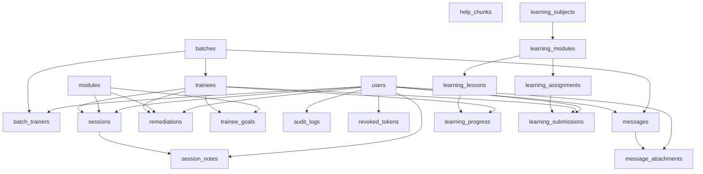

# Database Schema & Model Inventory (Phase 2A Baseline)

**Project**: Training Analytics Portal  
**Milestone**: Sprint 2 Phase 2A — PostgreSQL & Migration Foundation  
**Total Managed Tables**: 20  

## 1. Table Dependency & Migration Ordering Graph

## 2. Table Technical Specification

### Table: `audit_logs`

| Column | Type | Nullable | Primary Key | Default / Server Default |
| :--- | :--- | :---: | :---: | :--- |
| `id` | `INTEGER` | False | True | `None` |
| `actor_id` | `INTEGER` | True | False | `None` |
| `user_id` | `INTEGER` | True | False | `None` |
| `action` | `VARCHAR(100)` | False | False | `None` |
| `entity_type` | `VARCHAR(50)` | False | False | `None` |
| `entity_id` | `INTEGER` | True | False | `None` |
| `timestamp` | `DATETIME` | False | False | `now()` |
| `created_at` | `DATETIME` | False | False | `now()` |
| `before` | `JSON` | True | False | `None` |
| `after` | `JSON` | True | False | `None` |
| `details` | `JSON` | True | False | `None` |

**Foreign Key Relationships:**
- `actor_id` &rarr; `users.id` (ON DELETE `SET NULL`)

**Indexes:**
- `ix_audit_logs_id`: [`id`]
- `ix_audit_logs_timestamp`: [`timestamp`]
- `ix_audit_logs_user_id`: [`user_id`]
- `ix_audit_logs_entity_id`: [`entity_id`]
- `ix_audit_logs_created_at`: [`created_at`]
- `ix_audit_logs_action`: [`action`]
- `ix_audit_logs_entity_type`: [`entity_type`]
- `ix_audit_logs_actor_id`: [`actor_id`]

---

### Table: `batch_trainers`

| Column | Type | Nullable | Primary Key | Default / Server Default |
| :--- | :--- | :---: | :---: | :--- |
| `id` | `INTEGER` | False | True | `None` |
| `batch_id` | `INTEGER` | False | False | `None` |
| `trainer_id` | `INTEGER` | False | False | `None` |
| `assigned_at` | `DATETIME` | False | False | `now()` |

**Foreign Key Relationships:**
- `trainer_id` &rarr; `users.id` (ON DELETE `CASCADE`)
- `batch_id` &rarr; `batches.id` (ON DELETE `CASCADE`)

**Table Constraints:**
- `uq_batch_trainer` (UniqueConstraint): `Unique`

**Indexes:**
- `ix_batch_trainers_batch_id`: [`batch_id`]
- `ix_batch_trainers_batch_trainer`: [`batch_id`, `trainer_id`]
- `ix_batch_trainers_id`: [`id`]
- `ix_batch_trainers_trainer_id`: [`trainer_id`]

---

### Table: `batches`

| Column | Type | Nullable | Primary Key | Default / Server Default |
| :--- | :--- | :---: | :---: | :--- |
| `id` | `INTEGER` | False | True | `None` |
| `name` | `VARCHAR(100)` | False | False | `None` |
| `start_date` | `DATE` | False | False | `None` |
| `end_date` | `DATE` | False | False | `None` |

**Indexes:**
- `ix_batches_name`: [`name`] (UNIQUE)
- `ix_batches_id`: [`id`]

---

### Table: `help_chunks`

| Column | Type | Nullable | Primary Key | Default / Server Default |
| :--- | :--- | :---: | :---: | :--- |
| `id` | `INTEGER` | False | True | `None` |
| `source_path` | `VARCHAR(255)` | False | False | `None` |
| `heading` | `VARCHAR(255)` | False | False | `None` |
| `role` | `VARCHAR(20)` | False | False | `all` |
| `text` | `TEXT` | False | False | `None` |
| `created_at` | `DATETIME` | False | False | `now()` |

**Table Constraints:**
- `chk_help_chunk_text_max_length` (CheckConstraint): `length(text) <= 2000`
- `chk_help_chunk_role_valid` (CheckConstraint): `role IN ('trainer', 'trainee', 'admin', 'all')`
- `chk_help_chunk_text_non_empty` (CheckConstraint): `length(trim(text)) > 0`

**Indexes:**
- `ix_help_chunks_id`: [`id`]
- `ix_help_chunks_heading`: [`heading`]
- `ix_help_chunks_role`: [`role`]
- `ix_help_chunks_source_path`: [`source_path`]
- `ix_help_chunks_source_role`: [`source_path`, `role`]

---

### Table: `learning_assignments`

| Column | Type | Nullable | Primary Key | Default / Server Default |
| :--- | :--- | :---: | :---: | :--- |
| `id` | `INTEGER` | False | True | `None` |
| `module_id` | `INTEGER` | False | False | `None` |
| `title` | `VARCHAR(200)` | False | False | `None` |
| `instructions` | `TEXT` | False | False | `None` |
| `starter_files_url` | `VARCHAR(500)` | True | False | `None` |
| `max_score` | `INTEGER` | False | False | `100` |
| `passing_score` | `INTEGER` | False | False | `70` |
| `is_required` | `BOOLEAN` | False | False | `True` |

**Foreign Key Relationships:**
- `module_id` &rarr; `learning_modules.id` (ON DELETE `CASCADE`)

**Table Constraints:**
- `unnamed` (UniqueConstraint): `Unique`

**Indexes:**
- `ix_learning_assignments_id`: [`id`]

---

### Table: `learning_lessons`

| Column | Type | Nullable | Primary Key | Default / Server Default |
| :--- | :--- | :---: | :---: | :--- |
| `id` | `INTEGER` | False | True | `None` |
| `module_id` | `INTEGER` | False | False | `None` |
| `title` | `VARCHAR(200)` | False | False | `None` |
| `description` | `TEXT` | True | False | `None` |
| `video_relative_path` | `VARCHAR(500)` | True | False | `None` |
| `subtitle_relative_path` | `VARCHAR(500)` | True | False | `None` |
| `duration_seconds` | `INTEGER` | False | False | `0` |
| `order_index` | `INTEGER` | False | False | `1` |
| `companion_files` | `JSON` | True | False | `None` |
| `requires_practice` | `BOOLEAN` | False | False | `False` |

**Foreign Key Relationships:**
- `module_id` &rarr; `learning_modules.id` (ON DELETE `CASCADE`)

**Indexes:**
- `ix_learning_lessons_module_order`: [`module_id`, `order_index`]
- `ix_learning_lessons_id`: [`id`]

---

### Table: `learning_modules`

| Column | Type | Nullable | Primary Key | Default / Server Default |
| :--- | :--- | :---: | :---: | :--- |
| `id` | `INTEGER` | False | True | `None` |
| `subject_id` | `INTEGER` | False | False | `None` |
| `title` | `VARCHAR(150)` | False | False | `None` |
| `slug` | `VARCHAR(150)` | False | False | `None` |
| `order_index` | `INTEGER` | False | False | `1` |
| `description` | `TEXT` | True | False | `None` |
| `is_required` | `BOOLEAN` | False | False | `True` |

**Foreign Key Relationships:**
- `subject_id` &rarr; `learning_subjects.id` (ON DELETE `CASCADE`)

**Indexes:**
- `ix_learning_modules_slug`: [`slug`]
- `ix_learning_modules_subject_order`: [`subject_id`, `order_index`]
- `ix_learning_modules_id`: [`id`]

---

### Table: `learning_progress`

| Column | Type | Nullable | Primary Key | Default / Server Default |
| :--- | :--- | :---: | :---: | :--- |
| `id` | `INTEGER` | False | True | `None` |
| `trainee_id` | `INTEGER` | False | False | `None` |
| `lesson_id` | `INTEGER` | False | False | `None` |
| `watched_seconds` | `INTEGER` | False | False | `0` |
| `is_completed` | `BOOLEAN` | False | False | `False` |
| `last_watched_at` | `DATETIME` | False | False | `now()` |
| `completed_at` | `DATETIME` | True | False | `None` |

**Foreign Key Relationships:**
- `lesson_id` &rarr; `learning_lessons.id` (ON DELETE `CASCADE`)
- `trainee_id` &rarr; `trainees.id` (ON DELETE `CASCADE`)

**Table Constraints:**
- `uq_trainee_lesson_progress` (UniqueConstraint): `Unique`

**Indexes:**
- `ix_learning_progress_lesson_id`: [`lesson_id`]
- `ix_learning_progress_id`: [`id`]
- `ix_learning_progress_trainee_completed`: [`trainee_id`, `is_completed`]
- `ix_learning_progress_trainee_id`: [`trainee_id`]

---

### Table: `learning_subjects`

| Column | Type | Nullable | Primary Key | Default / Server Default |
| :--- | :--- | :---: | :---: | :--- |
| `id` | `INTEGER` | False | True | `None` |
| `title` | `VARCHAR(150)` | False | False | `None` |
| `slug` | `VARCHAR(150)` | False | False | `None` |
| `description` | `TEXT` | True | False | `None` |
| `icon` | `VARCHAR(50)` | False | False | `terminal` |
| `is_active` | `BOOLEAN` | False | False | `True` |
| `created_at` | `DATETIME` | False | False | `now()` |

**Indexes:**
- `ix_learning_subjects_id`: [`id`]
- `ix_learning_subjects_slug`: [`slug`] (UNIQUE)

---

### Table: `learning_submissions`

| Column | Type | Nullable | Primary Key | Default / Server Default |
| :--- | :--- | :---: | :---: | :--- |
| `id` | `INTEGER` | False | True | `None` |
| `assignment_id` | `INTEGER` | False | False | `None` |
| `trainee_id` | `INTEGER` | False | False | `None` |
| `status` | `VARCHAR(30)` | False | False | `submitted` |
| `commands_used` | `TEXT` | True | False | `None` |
| `explanation` | `TEXT` | True | False | `None` |
| `file_attachments` | `JSON` | True | False | `None` |
| `score` | `INTEGER` | True | False | `None` |
| `trainer_feedback` | `TEXT` | True | False | `None` |
| `reviewer_id` | `INTEGER` | True | False | `None` |
| `submitted_at` | `DATETIME` | False | False | `now()` |
| `reviewed_at` | `DATETIME` | True | False | `None` |

**Foreign Key Relationships:**
- `trainee_id` &rarr; `trainees.id` (ON DELETE `CASCADE`)
- `reviewer_id` &rarr; `users.id` (ON DELETE `SET NULL`)
- `assignment_id` &rarr; `learning_assignments.id` (ON DELETE `CASCADE`)

**Indexes:**
- `ix_learning_submissions_assignment_id`: [`assignment_id`]
- `ix_learning_submission_status`: [`status`]
- `ix_learning_submissions_id`: [`id`]
- `ix_learning_submission_trainee_assignment`: [`trainee_id`, `assignment_id`]
- `ix_learning_submissions_trainee_id`: [`trainee_id`]

---

### Table: `message_attachments`

| Column | Type | Nullable | Primary Key | Default / Server Default |
| :--- | :--- | :---: | :---: | :--- |
| `id` | `INTEGER` | False | True | `None` |
| `message_id` | `INTEGER` | False | False | `None` |
| `original_filename` | `VARCHAR(255)` | False | False | `None` |
| `stored_path` | `VARCHAR(500)` | False | False | `None` |
| `mime_type` | `VARCHAR(100)` | False | False | `None` |
| `size_bytes` | `INTEGER` | False | False | `None` |
| `uploaded_by` | `INTEGER` | False | False | `None` |
| `created_at` | `DATETIME` | False | False | `now()` |

**Foreign Key Relationships:**
- `uploaded_by` &rarr; `users.id` (ON DELETE `CASCADE`)
- `message_id` &rarr; `messages.id` (ON DELETE `CASCADE`)

**Indexes:**
- `ix_message_attachments_id`: [`id`]
- `ix_message_attachments_message_id`: [`message_id`]

---

### Table: `messages`

| Column | Type | Nullable | Primary Key | Default / Server Default |
| :--- | :--- | :---: | :---: | :--- |
| `id` | `INTEGER` | False | True | `None` |
| `channel` | `VARCHAR(20)` | False | False | `private` |
| `sender_id` | `INTEGER` | False | False | `None` |
| `recipient_id` | `INTEGER` | True | False | `None` |
| `batch_id` | `INTEGER` | True | False | `None` |
| `body` | `VARCHAR(500)` | True | False | `None` |
| `created_at` | `DATETIME` | False | False | `now()` |
| `read_at` | `DATETIME` | True | False | `None` |

**Foreign Key Relationships:**
- `sender_id` &rarr; `users.id` (ON DELETE `CASCADE`)
- `batch_id` &rarr; `batches.id` (ON DELETE `CASCADE`)
- `recipient_id` &rarr; `users.id` (ON DELETE `CASCADE`)

**Table Constraints:**
- `chk_message_channel_targets` (CheckConstraint): `(channel = 'private' AND recipient_id IS NOT NULL AND batch_id IS NULL) OR (channel = 'batch' AND recipient_id IS NULL AND batch_id IS NOT NULL)`
- `chk_message_not_self` (CheckConstraint): `recipient_id IS NULL OR sender_id != recipient_id`
- `chk_message_body_non_empty` (CheckConstraint): `body IS NULL OR length(trim(body)) > 0`
- `chk_message_body_max_length` (CheckConstraint): `body IS NULL OR length(body) <= 500`

**Indexes:**
- `ix_messages_batch_created`: [`batch_id`, `created_at`]
- `ix_messages_sender_id`: [`sender_id`]
- `ix_messages_sender_recipient_created`: [`sender_id`, `recipient_id`, `created_at`]
- `ix_messages_channel`: [`channel`]
- `ix_messages_batch_id`: [`batch_id`]
- `ix_messages_recipient_id`: [`recipient_id`]
- `ix_messages_id`: [`id`]
- `ix_messages_created_at`: [`created_at`]

---

### Table: `modules`

| Column | Type | Nullable | Primary Key | Default / Server Default |
| :--- | :--- | :---: | :---: | :--- |
| `id` | `INTEGER` | False | True | `None` |
| `name` | `VARCHAR(150)` | False | False | `None` |
| `max_score` | `FLOAT` | False | False | `None` |

**Table Constraints:**
- `chk_module_max_score_positive` (CheckConstraint): `max_score > 0`

**Indexes:**
- `ix_modules_id`: [`id`]
- `ix_modules_name`: [`name`] (UNIQUE)

---

### Table: `remediations`

| Column | Type | Nullable | Primary Key | Default / Server Default |
| :--- | :--- | :---: | :---: | :--- |
| `id` | `INTEGER` | False | True | `None` |
| `trainee_id` | `INTEGER` | False | False | `None` |
| `module_id` | `INTEGER` | False | False | `None` |
| `assigned_by` | `INTEGER` | True | False | `None` |
| `assigned_at` | `DATETIME` | False | False | `<function Remediation.<lambda> at 0x00000206F7D0BE20>` |
| `note` | `VARCHAR(500)` | True | False | `None` |
| `status` | `VARCHAR(50)` | False | False | `Pending` |
| `completed_at` | `DATETIME` | True | False | `None` |
| `completion_notes` | `VARCHAR(500)` | True | False | `None` |
| `reassessment_score` | `FLOAT` | True | False | `None` |
| `resolved_at` | `DATETIME` | True | False | `None` |
| `resolved_by` | `INTEGER` | True | False | `None` |

**Foreign Key Relationships:**
- `resolved_by` &rarr; `users.id` (ON DELETE `SET NULL`)
- `assigned_by` &rarr; `users.id` (ON DELETE `SET NULL`)
- `trainee_id` &rarr; `trainees.id` (ON DELETE `CASCADE`)
- `module_id` &rarr; `modules.id` (ON DELETE `CASCADE`)

**Indexes:**
- `ix_remediations_module_id`: [`module_id`]
- `ix_remediations_id`: [`id`]
- `ix_remediations_trainee_id`: [`trainee_id`]

---

### Table: `revoked_tokens`

| Column | Type | Nullable | Primary Key | Default / Server Default |
| :--- | :--- | :---: | :---: | :--- |
| `id` | `INTEGER` | False | True | `None` |
| `jti` | `VARCHAR(64)` | True | False | `None` |
| `user_id` | `INTEGER` | False | False | `None` |
| `revoked_at` | `DATETIME` | False | False | `<function RevokedToken.<lambda> at 0x00000206F7D7BC40>` |
| `expires_at` | `DATETIME` | True | False | `None` |
| `reason` | `VARCHAR(50)` | False | False | `logout` |

**Foreign Key Relationships:**
- `user_id` &rarr; `users.id` (ON DELETE `CASCADE`)

**Indexes:**
- `ix_revoked_tokens_user_id`: [`user_id`]
- `ix_revoked_tokens_expires_at`: [`expires_at`]
- `ix_revoked_tokens_jti`: [`jti`] (UNIQUE)
- `ix_revoked_tokens_id`: [`id`]

---

### Table: `session_notes`

| Column | Type | Nullable | Primary Key | Default / Server Default |
| :--- | :--- | :---: | :---: | :--- |
| `id` | `INTEGER` | False | True | `None` |
| `session_id` | `INTEGER` | False | False | `None` |
| `author_id` | `INTEGER` | False | False | `None` |
| `text` | `VARCHAR(300)` | False | False | `None` |
| `created_at` | `DATETIME` | False | False | `now()` |

**Foreign Key Relationships:**
- `session_id` &rarr; `sessions.id` (ON DELETE `CASCADE`)
- `author_id` &rarr; `users.id` (ON DELETE `CASCADE`)

**Table Constraints:**
- `chk_session_note_text_length` (CheckConstraint): `length(text) <= 300`

**Indexes:**
- `ix_session_notes_session_id`: [`session_id`]
- `ix_session_notes_session_created`: [`session_id`, `created_at`]
- `ix_session_notes_id`: [`id`]
- `ix_session_notes_author_id`: [`author_id`]
- `ix_session_notes_created_at`: [`created_at`]

---

### Table: `sessions`

| Column | Type | Nullable | Primary Key | Default / Server Default |
| :--- | :--- | :---: | :---: | :--- |
| `id` | `INTEGER` | False | True | `None` |
| `trainee_id` | `INTEGER` | False | False | `None` |
| `module_id` | `INTEGER` | False | False | `None` |
| `score` | `FLOAT` | False | False | `None` |
| `errors` | `INTEGER` | False | False | `None` |
| `time_seconds` | `INTEGER` | False | False | `None` |
| `created_at` | `DATETIME` | False | False | `now()` |
| `created_by` | `INTEGER` | True | False | `None` |
| `is_practice` | `BOOLEAN` | False | False | `False` |

**Foreign Key Relationships:**
- `module_id` &rarr; `modules.id` (ON DELETE `CASCADE`)
- `trainee_id` &rarr; `trainees.id` (ON DELETE `CASCADE`)
- `created_by` &rarr; `users.id` (ON DELETE `SET NULL`)

**Table Constraints:**
- `chk_session_time_max_limit` (CheckConstraint): `time_seconds <= 14400`
- `chk_session_errors_non_negative` (CheckConstraint): `errors >= 0`
- `chk_session_time_non_negative` (CheckConstraint): `time_seconds >= 0`
- `chk_session_score_non_negative` (CheckConstraint): `score >= 0`

**Indexes:**
- `ix_sessions_module_id`: [`module_id`]
- `ix_sessions_trainee_id_created_at`: [`trainee_id`, `created_at`]
- `ix_sessions_created_by`: [`created_by`]
- `ix_sessions_trainee_module_created`: [`trainee_id`, `module_id`, `created_at`]
- `ix_sessions_created_at`: [`created_at`]
- `ix_sessions_id`: [`id`]

---

### Table: `trainee_goals`

| Column | Type | Nullable | Primary Key | Default / Server Default |
| :--- | :--- | :---: | :---: | :--- |
| `id` | `INTEGER` | False | True | `None` |
| `trainee_id` | `INTEGER` | False | False | `None` |
| `module_id` | `INTEGER` | False | False | `None` |
| `target_score` | `FLOAT` | False | False | `None` |
| `created_at` | `DATETIME` | False | False | `<function TraineeGoal.<lambda> at 0x00000206F7D3E200>` |
| `updated_at` | `DATETIME` | False | False | `<function TraineeGoal.<lambda> at 0x00000206F7D3E3E0>` |

**Foreign Key Relationships:**
- `trainee_id` &rarr; `trainees.id` (ON DELETE `CASCADE`)
- `module_id` &rarr; `modules.id` (ON DELETE `CASCADE`)

**Table Constraints:**
- `uq_trainee_module_goal` (UniqueConstraint): `Unique`

**Indexes:**
- `ix_trainee_goals_module_id`: [`module_id`]
- `ix_trainee_goals_id`: [`id`]
- `ix_trainee_goals_trainee_id`: [`trainee_id`]

---

### Table: `trainees`

| Column | Type | Nullable | Primary Key | Default / Server Default |
| :--- | :--- | :---: | :---: | :--- |
| `id` | `INTEGER` | False | True | `None` |
| `name` | `VARCHAR(120)` | False | False | `None` |
| `email` | `VARCHAR(255)` | False | False | `None` |
| `batch_id` | `INTEGER` | False | False | `None` |
| `phone` | `VARCHAR(40)` | True | False | `None` |
| `bio` | `TEXT` | True | False | `None` |
| `specialization` | `VARCHAR(120)` | True | False | `None` |
| `avatar_url` | `TEXT` | True | False | `None` |
| `github_url` | `VARCHAR(255)` | True | False | `None` |

**Foreign Key Relationships:**
- `batch_id` &rarr; `batches.id` (ON DELETE `CASCADE`)

**Indexes:**
- `ix_trainees_batch_id`: [`batch_id`]
- `ix_trainees_email`: [`email`] (UNIQUE)
- `ix_trainees_id`: [`id`]

---

### Table: `users`

| Column | Type | Nullable | Primary Key | Default / Server Default |
| :--- | :--- | :---: | :---: | :--- |
| `id` | `INTEGER` | False | True | `None` |
| `email` | `VARCHAR(255)` | False | False | `None` |
| `password_hash` | `VARCHAR(255)` | False | False | `None` |
| `role` | `VARCHAR(20)` | False | False | `None` |
| `is_active` | `BOOLEAN` | False | False | `True` |
| `trainee_id` | `INTEGER` | True | False | `None` |

**Foreign Key Relationships:**
- `trainee_id` &rarr; `trainees.id` (ON DELETE `SET NULL`)

**Table Constraints:**
- `chk_user_role_valid` (CheckConstraint): `role IN ('admin', 'trainer', 'trainee')`
- `unnamed` (UniqueConstraint): `Unique`

**Indexes:**
- `ix_users_id`: [`id`]
- `ix_users_email`: [`email`] (UNIQUE)

---

## 3. Runtime Schema Patches & Technical Debt Elimination

### In-Code Schema Patches Identified:
1. **`sessions.is_practice` in `backend/app/main.py`**:
   - **Current Implementation**: Dynamic SQL query (`PRAGMA table_info(sessions)`) executed on FastAPI startup lifespan, followed by raw `ALTER TABLE sessions ADD COLUMN is_practice BOOLEAN NOT NULL DEFAULT 0`.
   - **Technical Debt & Production Risk**: SQLite-specific syntax breaks on PostgreSQL; creates a race condition when multiple Gunicorn/Uvicorn worker processes start concurrently; circumvents version-controlled migration records.
   - **Phase 2A Solution**: Formally codified into Alembic migration `006_assessment_practice_sessions.py` with standard SQLAlchemy/Alembic primitives; removed from `main.py` startup sequence.

2. **Uncontrolled `Base.metadata.create_all()` in `backend/app/main.py`**:
   - **Current Implementation**: Automatically called on every startup regardless of environment.
   - **Technical Debt & Production Risk**: Fails to track schema drifts, will not add newly introduced columns to existing production tables, and causes concurrency collisions during zero-downtime rolling deploys.
   - **Phase 2A Solution**: Gated strictly to `ENVIRONMENT == "development"`. In `staging` and `production`, schema management is delegated solely to `alembic upgrade head` executed via CI/CD deployment pipelines.
